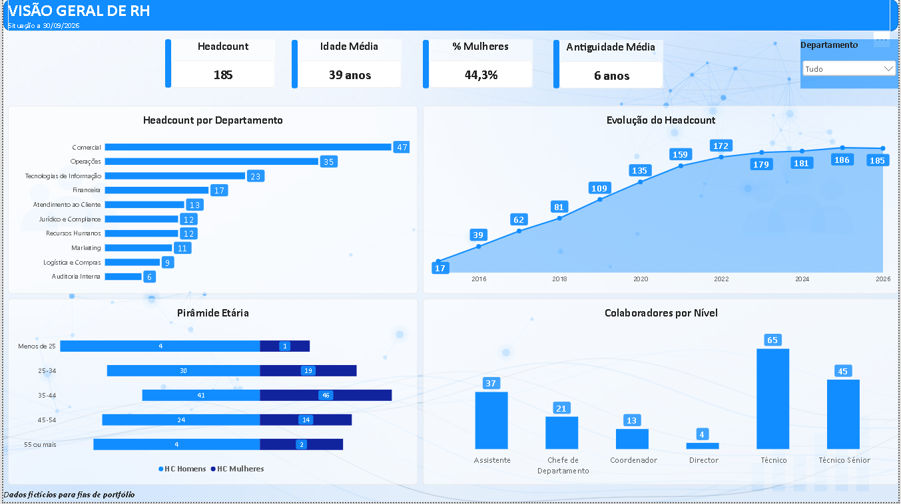
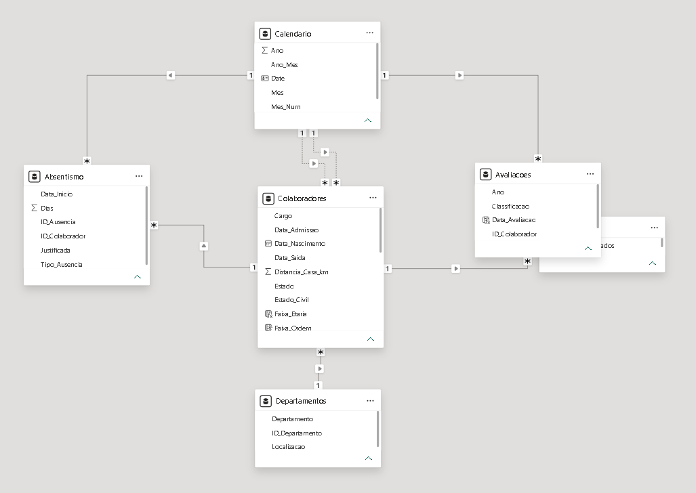
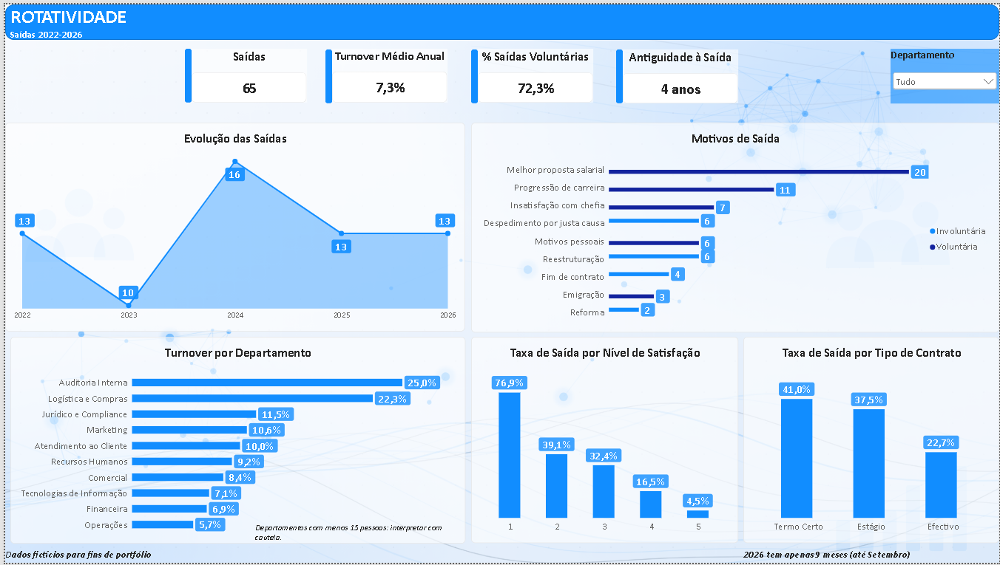
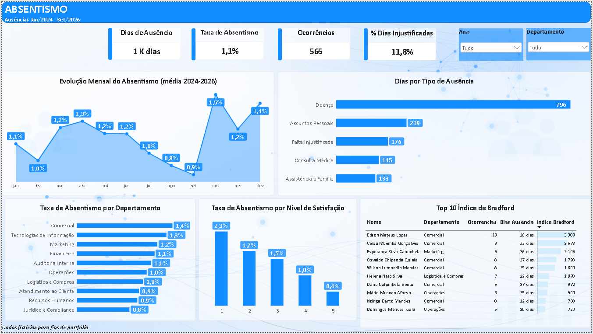
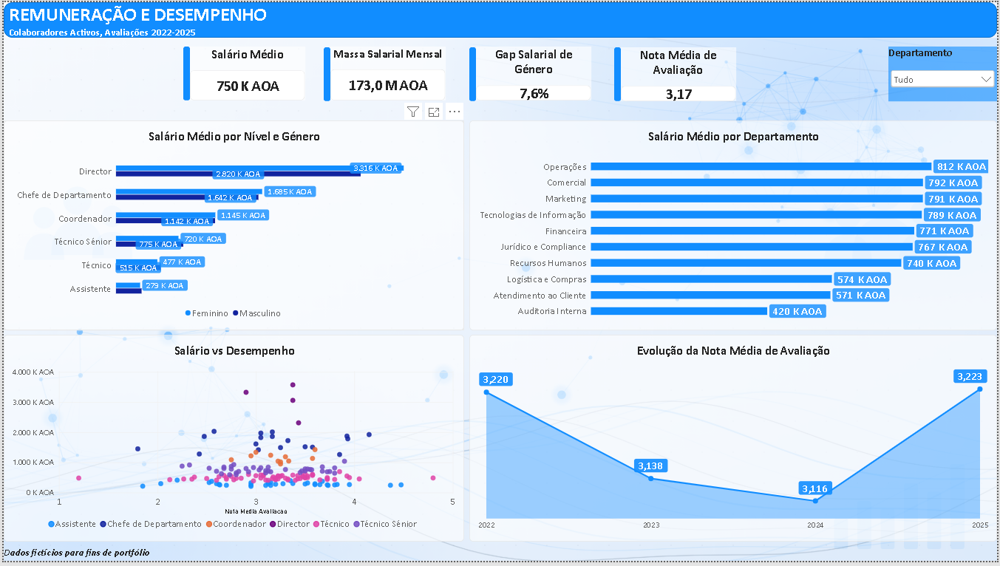

# 📊 People Analytics – Dashboard de Recursos Humanos em Power BI

Dashboard interactivo de **People Analytics** que analisa headcount, rotatividade, absentismo, remuneração e desempenho de uma empresa com 250 colaboradores, para apoiar decisões de gestão de pessoas com base em dados.

> ⚠️ **Dados 100% fictícios**, gerados para fins de formação e portefólio. Qualquer semelhança com pessoas ou empresas reais é coincidência.



---

## 🎯 Objectivo

Responder a quatro perguntas de negócio:

1. **Quem são os nossos colaboradores?** Estrutura, demografia e evolução do headcount.
2. **Quem sai, porquê e de onde?** Rotatividade, motivos e perfil de quem sai.
3. **Quanto tempo perdemos com ausências?** Absentismo por tipo, departamento e colaborador.
4. **Pagamos de forma justa e recompensamos o desempenho?** Remuneração, gap salarial de género e relação salário–avaliação.

---

## 🗂️ Dados

| Tabela | Linhas | Descrição |
|---|---|---|
| `Colaboradores` | 250 | Dados pessoais, departamento, cargo, nível, contrato, admissão/saída, salário, satisfação |
| `Departamentos` | 10 | Tabela de dimensão |
| `Avaliacoes` | 683 | Avaliação de desempenho anual (2022–2025), nota de 1 a 5 |
| `Absentismo` | 565 | Ausências entre Jan/2024 e Set/2026 |
| `Calendario` | — | Tabela de datas criada em DAX |

Data de referência: **30/09/2026** · Moeda: **Kwanza (AOA)**

---

## 🧩 Modelo de Dados

Modelo em **estrela**, com relações 1:N de filtro simples e uma tabela Calendário marcada como tabela de datas.



**Destaque técnico:** a tabela `Colaboradores` tem **duas relações inactivas** com o Calendário (`Data_Admissao` e `Data_Saida`), activadas nas medidas com `USERELATIONSHIP`. Isto permite contar admissões e saídas por período sem criar ambiguidade no modelo.

---

## 🧮 Medidas DAX principais

**Headcount numa data** (colaboradores activos no fim do período seleccionado):
```dax
Headcount =
VAR DataFim = MAX ( Calendario[Date] )
RETURN
COUNTROWS (
    FILTER (
        Colaboradores,
        Colaboradores[Data_Admissao] <= DataFim
            && ( ISBLANK ( Colaboradores[Data_Saida] ) || Colaboradores[Data_Saida] > DataFim )
    )
)
```

**Saídas** (activando a relação inactiva):
```dax
Saidas =
CALCULATE (
    COUNTROWS ( Colaboradores ),
    USERELATIONSHIP ( Calendario[Date], Colaboradores[Data_Saida] ),
    NOT ISBLANK ( Colaboradores[Data_Saida] )
)
```

**Taxa de rotatividade média anual:**
```dax
Taxa Rotatividade = DIVIDE ( [Saidas], [Headcount Medio] )

Taxa Rotatividade Media Anual =
AVERAGEX ( VALUES ( Calendario[Ano] ), [Taxa Rotatividade] )
```

**Índice de Bradford** (ocorrências² × dias, que penaliza as ausências curtas e frequentes):
```dax
Indice Bradford =
SUMX (
    VALUES ( Colaboradores[ID_Colaborador] ),
    VAR S = CALCULATE ( COUNTROWS ( Absentismo ) )
    VAR D = CALCULATE ( SUM ( Absentismo[Dias] ) )
    RETURN S * S * D
)
```

**Gap salarial de género:**
```dax
Gap Salarial Genero =
DIVIDE ( [Salario Medio Homens] - [Salario Medio Mulheres], [Salario Medio Homens] )
```

---

## 📑 Páginas do Dashboard

### 1. Visão Geral
Headcount, idade média, % de mulheres, antiguidade, evolução do headcount, pirâmide etária e estrutura por nível.


### 2. Rotatividade
Saídas 2022–2026, motivos (voluntários e involuntários), turnover por departamento e taxa de saída por satisfação e tipo de contrato.


### 3. Absentismo
Dias perdidos, taxa de absentismo, sazonalidade, tipos de ausência, absentismo por satisfação e Top 10 do Índice de Bradford.


### 4. Remuneração e Desempenho
Salário médio, massa salarial, gap salarial de género por nível e dispersão salário × avaliação.


---

## 💡 Principais conclusões

**1. A satisfação é o factor que mais explica a saída.**
Dos colaboradores com satisfação 1 (em 5), **76,9% saíram**, contra apenas **4,5%** dos que deram nota 5. Os mais insatisfeitos também **faltam cerca de 5 vezes mais** (taxa de absentismo de 2,3% contra 0,4%).

**2. A maior parte das saídas podia ter sido evitada.**
**72% das saídas são voluntárias**, e o principal motivo é **"melhor proposta salarial"**, seguido de **"progressão de carreira"**.

**3. Os contratos precários aumentam o risco de saída.**
A taxa de saída é de **41%** nos contratos a termo certo, contra **22,7%** nos efectivos.

**4. Existe um gap salarial de género de cerca de 7,6%**, concentrado nos níveis de base e intermédios (Assistente, Técnico e Técnico Sénior), onde as mulheres ganham **5% a 7,5% menos no mesmo nível**. Nos cargos de chefia não se observa esta diferença, embora a amostra seja pequena.

**5. O salário não reflecte o desempenho.**
A correlação entre o salário e a nota média de avaliação é praticamente **nula**. O salário é determinado pelo nível hierárquico, não pelo mérito. Junto com a conclusão 2, isto ajuda a explicar porque é que os colaboradores saem por melhores propostas salariais.

---

## ✅ Recomendações de gestão

- Criar um **sistema de alerta precoce** de saída, com base no inquérito de satisfação.
- Rever a **política de remuneração variável**, ligando parte da remuneração à avaliação de desempenho.
- Realizar uma **auditoria de equidade salarial** nos níveis Assistente, Técnico e Técnico Sénior.
- Avaliar a **conversão de contratos a termo** em efectivos para os colaboradores com bom desempenho.
- Acompanhar os colaboradores com **Índice de Bradford elevado** com conversas de apoio, e não apenas disciplinares.

---

## 🛠️ Desafios técnicos resolvidos

| Desafio | Solução |
|---|---|
| Separador de argumentos em DAX (`;` vs `,`) | Identificar as definições regionais do Power BI |
| Contar admissões e saídas pela data sem ambiguidade | Relações inactivas + `USERELATIONSHIP` |
| Dependência circular ao ordenar `Nivel` por uma coluna DAX | Criar a coluna de ordenação no **Power Query** |
| Linha "em branco" nas saídas (colaboradores activos) | Filtro `NOT ISBLANK` na medida |
| Pirâmide etária (não existe visual nativo) | Medida com valores negativos para um dos géneros + formato `0;0` |
| Taxa de absentismo subestimada no ano parcial | Limitar os dias úteis à data de referência |
| Filtro de ano sem efeito nos salários | Reconhecer o limite dos dados (sem histórico salarial) e não forçar comparações enganadoras |

---

## 🧰 Ferramentas

**Power BI Desktop** · **Power Query** · **DAX** · **Excel**

---

## 👤 Autor

**Dielukunsia António Lucas**
Economista · Analista de Dados / People Analytics
📧 benylson98@gmail.com · 🔗 [LinkedIn](https://www.linkedin.com/in/dielukunsia-lucas-1)
